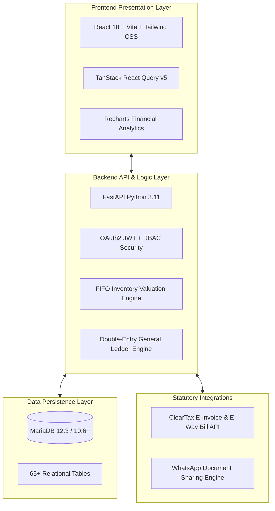
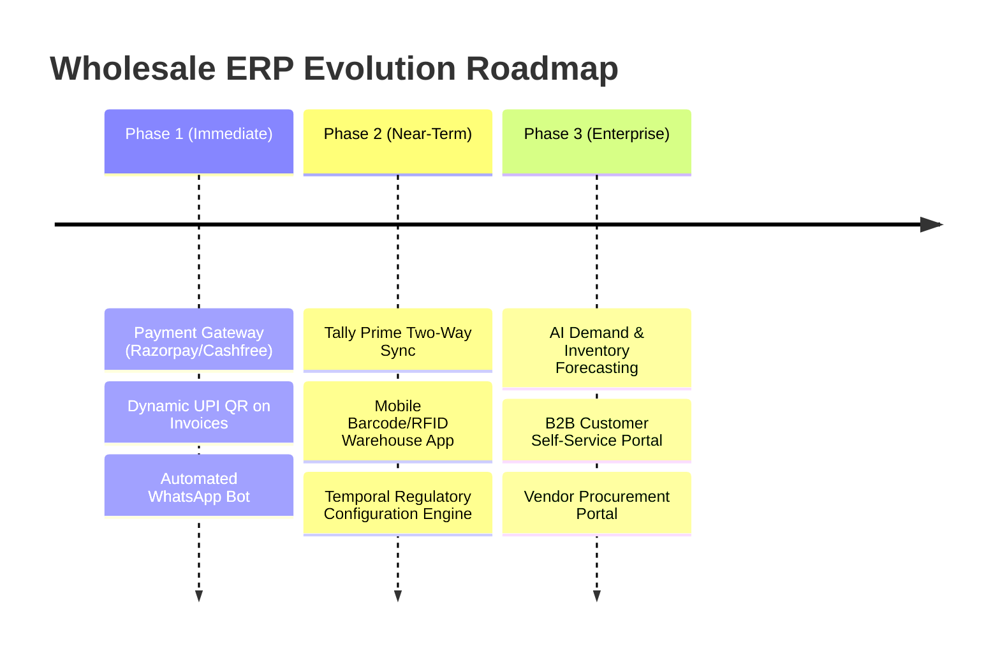

# Vignesh GrowthLab Wholesale ERP — Complete System Walkthrough & Feature Inventory

An end-to-end master guide detailing the entire functional architecture, module capabilities, statutory compliance mechanisms, and future roadmap of the **Vignesh GrowthLab (VGL) Wholesale Enterprise Resource Planning (ERP)** platform.

---

## 1. System Overview & Technology Stack

The Vignesh GrowthLab Wholesale ERP is an enterprise-grade wholesale, distribution, and financial management suite tailored specifically for Indian wholesale distributors, multi-warehouse stockists, and trading enterprises.



### Core Architecture Pillars:
- **High-Performance Backend:** Python 3.11 with FastAPI (asynchronous, auto-generating OpenAPI 3.0 docs at `/api/docs`).
- **Responsive Frontend:** React 18, Vite, Tailwind CSS, Lucide icons, and React Query v5 for cached server state.
- **Relational Enterprise Store:** MariaDB with 65+ normalized tables, transaction isolation, and row-level locking for atomic sequence generation.
- **Statutory Indian Compliance:** Built native for Indian GST laws (CGST, SGST, IGST), HSN validation (4, 6, or 8 digits), ClearTax IRN/QR generation, and E-Way bill logistics.
- **Financial Rigor:** Strict double-entry accounting where every purchase, sale, expense, and stock write-off auto-posts balanced journals.
- **Inventory Valuation:** True FIFO (First-In, First-Out) stock layers tracking actual cost of goods sold (COGS).

---

## 2. Comprehensive Module Inventory (All 10 Core Modules)

### Module 1: Master Settings & System Configuration
- **Company Profile:** Corporate identity, legal trade name, registered GSTIN, state code, CIN, PAN, and address.
- **Bank & UPI Profile:** Corporate bank accounts (Account Name, Bank Name, Account Number, IFSC, Branch) and UPI ID.
- **Financial Year Engine:** Multi-year support with Indian April 1 – March 31 financial year definitions (`2026-27`).
- **Atomic Invoice Sequences:** Row-locked sequence generator with custom prefixes (`VGL/26-27/001`, `DC/26-27/001`, `PO/26-27/001`) preventing number collisions or race conditions.
- **Branding:** Dynamic company logo upload rendered across all printable invoices, Delivery Challans, and quotations.
- **Granular Permissions Matrix:** Role-based access control with page-level overrides per individual user.

---

### Module 2: Products & Inventory Management
- **Category Hierarchy:** Hierarchical categorization with category-prefixed part code auto-generation (e.g., `ELE-001`).
- **Standardized HSN Code Validation:** Enforces strict Indian HSN format (validates 4, 6, or 8 numeric digits) with default GST tax slab mapping.
- **4-Tier Pricing Structure:**
  1. `purchase_cost`: Actual procurement cost per unit.
  2. `b2b_price`: Wholesale pricing for trade customers.
  3. `b2c_price`: Dealer and retail pricing.
  4. `mrp`: Maximum Retail Price printed on packaging.
- **Cost-Floor Validation Guard:** Enforces mathematical safety rule: $\text{Cost} \le \text{B2B} \le \text{B2C} \le \text{MRP}$. Prevents negative-margin sales at entry time.
- **Effective-Dated Price History Engine:** Price changes can be scheduled in advance with an `effective_from` date; automated activation triggers once the date arrives.
- **Margin & Cost-Loss Alerts:** In-app alert system flagging items selling below cost or beneath the minimum company profit margin threshold.
- **True FIFO Layer Tracking:** Records every batch into `stock_entries` (product, warehouse, batch date, remaining quantity, unit cost). Stock consumption strictly depletes the oldest batches first.
- **Bulk Operations:** Excel/CSV import for mass catalog setup and bulk price adjustment tools.

---

### Module 3: Multi-Warehouse Management & Logistics
- **Multi-Location Hierarchy:** Unlimited physical warehouses, regional distribution centers, and showroom stockpoints.
- **Warehouse-Specific Bank Details:** Allows regional warehouses to print local branch accounts or UPI QR codes on dispatch invoices.
- **Inter-Warehouse Stock Transfers (DC-Linked):**
  - Step 1: Dispatch warehouse initiates transfer, stock is immediately reserved/deducted.
  - Step 2: Delivery Challan (DC) is issued with vehicle and transporter details.
  - Step 3: Destination warehouse inspects and confirms receipt, crediting stock locally.
  - Reversal: If rejected at destination, goods are restored back to source warehouse automatically.
- **Stock Adjustments:** Physical inventory audit corrections (`Adjustment In` adds FIFO batch; `Adjustment Out` consumes FIFO).
- **Stock Write-offs:** Governance workflow for damaged, expired, or lost stock:
  - Warehouse staff submits write-off request with reason codes.
  - Requires Admin/Super Admin approval before inventory is written off.
  - Automatically posts Loss/Damage Expense journal entries to the General Ledger upon approval.
- **Opening Balances:** Data-migration utility to seed initial warehouse quantities and opening ledger balances.

---

### Module 4: Procure-to-Pay (Purchases & Vendor Management)
- **Vendor Master:** Trade name, contact profiles, credit period (days), PAN, and GSTIN.
- **ClearTax Vendor Auto-Lookup:** Entering a GSTIN auto-queries ClearTax to fetch legal business name, trade name, and registered state code.
- **Purchase Orders (PO):** Inward purchase orders tracking estimated arrival dates and terms.
- **Purchase Bills Entry:**
  - Duplicate vendor invoice number detection per vendor.
  - Auto-detection of GST regime: Intra-state (CGST + SGST) vs Inter-state (IGST) based on vendor state vs warehouse state.
  - Automatically generates new FIFO stock layers in `stock_entries`.
  - Automatically updates the product's latest purchase cost and triggers price recalculations.
  - Posts double-entry journal: Debit Inventory Asset, Debit Input Tax Credit (CGST/SGST/IGST), Credit Sundry Creditors (Vendor).
- **Vendor Payments & Allocation:**
  - Records payments via Bank Transfer (NEFT/RTGS/IMPS), Cheque, Cash, or Advance.
  - Allocates payments against purchase bills in FIFO order (oldest outstanding bills settled first).
  - Advances tracking with automatic deduction against future purchases.
- **Purchase Reversal / Voiding:** Cancelling a purchase bill safely reverses inventory layers, cancels the vendor payable, and reverses the journal entry. (Guarded: blocked if goods have already been sold or consumed).

---

### Module 5: Order-to-Cash (Sales, Billing & Invoicing)
- **Customer Master:** Credit limit enforcement, customer classification (B2B wholesale, B2C retail), multiple shipping addresses, and GSTIN auto-lookup.
- **Quotations / Estimates:** Non-posting price estimates that can be converted into active B2B or B2C invoices with 1 click.
- **Delivery Challans (DC):** Dispatches for approval, job work, or exhibition with stock reservation without triggering premature tax liability.
- **Tax Invoices (B2B & B2C):**
  - Real-time stock availability check against the chosen dispatch warehouse.
  - Customer credit limit validation (warns or blocks if outstanding + invoice exceeds credit ceiling).
  - Multi-line items with individual discounts, HSN codes, notes, and serial numbers.
  - Auto-calculation of taxable amount, CGST, SGST, and IGST with round-off logic.
  - Real-time FIFO stock consumption recording exact historical COGS per line item.
  - Automated journal posting: Debit Sundry Debtors, Credit Sales Account, Credit Output GST Payable.
- **Credit Notes (Sales Returns):**
  - Links directly to the original invoice.
  - Restores stock back to inventory as `return_in`.
  - Reverses output GST liability and credits the customer's ledger balance.
- **Invoice Printing & Sharing:**
  - Clean A4 printable tax invoice format with standard declarations, bank details, and E. & O.E.
  - WhatsApp Invoice Sharing: One-click formatted WhatsApp link with Indian number formatting (`₹12,34,567.89`) and summary breakdown.
- **Receipts & Collections:**
  - Receipt entry via Cash, Bank, Cheque, or UPI.
  - FIFO allocation across customer's oldest pending invoices.

---

### Module 6: Financial Accounting & General Ledger
- **Standard Indian Chart of Accounts (COA):**
  - Assets: Cash in Hand, Bank Accounts, Sundry Debtors, Stock-in-Trade, Input Tax Credit (CGST/SGST/IGST).
  - Liabilities: Sundry Creditors, Output GST Payable (CGST/SGST/IGST), Duties & Taxes, Capital Accounts.
  - Revenue: Domestic Sales (B2B/B2C), Other Operating Income.
  - Expenses: Cost of Goods Sold (COGS), Warehouse Damaged Stock, Salaries, Rent, Utilities, Financial Charges.
- **Automated Double-Entry Posting:** All operational transactions (sales, purchases, receipts, payments, write-offs) create balanced `journal_entries` and `journal_lines` in real-time.
- **Manual Journal Entries:** Support for accountant adjustments, depreciation, and year-end provisions.
- **Receivables Ageing Buckets:**
  - Instant classification into `0-30 days`, `31-60 days`, `61-90 days`, and `90+ days`.
  - Collection Priority Scoring algorithm highlighting overdue high-exposure accounts.
- **Payables Ageing & Due Date Tracker:** Tracks upcoming vendor payment obligations based on invoice credit terms.
- **Daily Cash-in-Hand Closing:**
  - Opening Cash Balance + Daily Cash Receipts − Approved Cash Expenses = Calculated System Closing.
  - Accountant enters physical cash count to detect cash book variance.
  - Formal day closing lock preventing retroactive modifications.
- **Expense Management:**
  - Categorized expense logging (Rent, Freight, Stationery, etc.).
  - Approval threshold: Expenses over configurable threshold (e.g. ₹5,000) require Admin sign-off before posting to General Ledger.
- **TDS & Form 26AS Management:**
  - Deducts TDS under applicable sections (194C, 194J, 194Q).
  - Form 26AS import and automated reconciliation against book TDS entries.
- **Trial Balance:** Live debit/credit verification across all account heads for any custom date range or financial year.

---

### Module 7: Statutory Taxation (GST, E-Invoice & E-Way Bill)
- **ClearTax Cloud Integration:** Direct API pipeline for government portal communication.
  - Sandbox mode (`CLEARTAX_SANDBOX=true`) provides deterministic mock responses for offline testing without government portal credentials.
  - Production mode directly connects via official ClearTax Auth Tokens.
- **E-Invoicing (IRN & Signed QR):**
  - 1-click IRN (Invoice Reference Number) generation for eligible B2B invoices.
  - Cryptographic Signed QR code generation persisted directly on the invoice record for smartphone scanner verification.
  - 24-hour statutory cancellation workflow with mandatory government reason codes.
- **E-Way Bill Generation:**
  - Integrated Part A & Part B E-Way bill generation for consignments exceeding the threshold (e.g., ₹50,000).
  - Vehicle and transporter master data auto-populates vehicle registration, LR number, transporter ID, and transit distance.
- **GST Statutory Returns Preparation:**
  - **GSTR-1:** Outward supplies breakdown classified into B2B invoices, B2C Large, B2C Small, and Credit Notes.
  - **GSTR-2B Reconciliation:** Matches vendor purchase bills against downloaded government GSTR-2B JSON to claim Input Tax Credit (ITC) without mismatch penalties.
  - **GSTR-3B Summary:** Monthly consolidated tax computation: Total Output Tax Liability minus Eligible Input Tax Credit = Net Payable.

---

### Module 8: Banking, Cash & Treasury Management
- **Multi-Bank Account Management:** Track current accounts, OD/CC limits, and cash credit balances.
- **Cheque Register & Lifecycle Management:**
  - Full cheque status tracking: `Received` $\rightarrow$ `Deposited` $\rightarrow$ `Cleared` or `Bounced`.
  - Cheque Bounce Protection: Automatically triggers reversing entries against the customer's ledger, restores the original invoice balance, and logs bounce charges.
- **Bank Statement Reconciliation:**
  - CSV/Excel bank statement import.
  - Automated rule-based reconciliation matching bank statement transactions against ERP ledger entries by date, reference, and amount.
  - Clear reconciliation report highlighting matched items, uncredited deposits, and unpresented cheques.
- **Bank Stock Statement & Drawing Power Certificate:**
  - Automated month-end valuation of paid inventory using strict FIFO valuation.
  - Debtors ageing filter (includes only eligible debtors $<90$ days).
  - Computes exact Drawing Power (DP) after deducting bank margins (e.g., 25% on stock, 40% on debtors) against the sanctioned CC limit.
  - One-click export of formal banker-ready Drawing Power certificate.

---

### Module 9: Executive Reports & Business Intelligence
- **Executive Live Dashboard:**
  - Real-time KPIs: Today's Sales, Month-to-Date Revenue, Total Receivables, Total Payables, Net Cash in Hand, and Total Inventory Value.
  - Resilient query design: Each metric executes in an isolated transaction block so that an anomaly in one metric does not crash the dashboard.
- **Profit & Loss (P&L) Statement:**
  - True Gross Profit calculation: $\text{Gross Profit} = \text{Revenue} - \text{FIFO Cost of Goods Sold}$.
  - Net Profit calculation: Deducts operating overheads, logistics, and administrative expenses.
- **Sales Analysis Reports:** Salesperson performance, customer revenue contribution, product-wise profitability, and seasonal trends.
- **Purchase & Vendor Reports:** Cost movement tracking, vendor order fulfillment metrics, and procurement price variance.
- **Stock Valuation Report:** Side-by-side comparison of FIFO stock valuation versus replacement cost / latest purchase cost.
- **Comprehensive Day Book:** Unified chronological register of all sales, purchases, cash receipts, and payments recorded on any selected day.
- **Customer & Vendor Statement of Accounts:** Downloadable PDF/Excel statement with running debit/credit balances for sharing with trade partners.

---

### Module 10: Security, User Roles & Audit Governance
- **Role-Based Access Control (RBAC):**
  - `super_admin` / `system_administrator`: Unrestricted system access, database utilities, user administration, price overrides, and warehouse obsolescence.
  - `admin`: Enterprise operational control across all modules and settings.
  - `accountant`: Access to Purchases, Billing, Banking, Accounting, GST, and Financial Reports (restricted from user management).
  - `sales`: Restricted to customer management, quotations, sales invoices, and catalog viewing.
  - `warehouse`: Restricted to stock transfers, goods receipt, delivery challans, and stock counting.
- **Warehouse-Specific Scoping:** Users can be pinned to specific warehouses; their operations and inventory visibility are strictly scoped to their assigned location.
- **Security & Session Controls:**
  - Account lockout protection: Automatically locks user accounts after successive failed login attempts.
  - Dual-token authentication: Short-lived JWT access tokens with secure refresh token rotation.
  - Active Session Manager: Admins can view active device sessions and terminate unauthorized logins instantly.
  - Force Password Reset: Admin-mandated password updates on next login.
- **Comprehensive Audit Trail (`ActivityLog`):**
  - Immutable audit logs recording timestamp, user ID, IP address, action type, and JSON payload diff for sensitive operations (price changes, credit limit modifications, manual journals, stock write-offs).
  - Suspicious Activity Scanner: Automated scans flagging bulk data exports and anomalous login patterns.
- **DPDP Act Compliance Readiness:** Data retention and customer personal data erasure protocols aligned with Indian Digital Personal Data Protection standards.

---

## 3. Future Roadmap & Expansion Pipeline

The Wholesale ERP architecture has been engineered with modular hooks to support rapid expansion. The following features are planned and primed for rollout:



### 1. Online Payment Gateway Integration (Razorpay / Cashfree)
- **Payment Links:** Auto-generate payment links sent via SMS and WhatsApp along with the invoice.
- **Webhook Settlements:** Real-time webhook listener in FastAPI that automatically creates a `CustomerReceipt` and closes open invoice balances the moment a customer pays online.
- **Dynamic UPI QR on Printed Invoices:** Embedded NPCI-standard dynamic UPI QR code containing the company's VPA, exact invoice payable amount, and invoice reference number so customers can scan and pay instantly via PhonePe, Google Pay, or Paytm.

### 2. WhatsApp Business Cloud API Bot
- **Automated Invoice Delivery:** Instantly dispatch PDF invoices and Delivery Challans to customer WhatsApp numbers upon invoice finalization.
- **Automated Outstanding Reminders:** Scheduled cron job sending friendly payment reminders with ledger balance statements to overdue debtors.
- **Customer Self-Query Bot:** Allows registered customers to type "LEDGER" or "STATEMENT" to receive their latest account statement directly in WhatsApp.

### 3. Tally Prime / ERP 9 Two-Way Sync
- **XML / ODBC Data Bridge:** Two-way synchronization allowing external chartered accountants to export ERP sales, purchases, and journals directly into Tally Prime XML format without manual re-entry.

### 4. Barcode & RFID Mobile Warehouse Scanning
- **Mobile PWA / Handheld Scanner Interface:** Dedicated mobile camera and Zebra/Honeywell barcode scanner support.
- **Instant GRN & Dispatch Picking:** Scan product barcodes to populate purchase receipts (GRN) and verify items against invoices during dispatch packing to achieve zero-error shipments.

### 5. Temporal Configuration Engine (Regulatory Versioning)
*(Detailed in `docs/CONFIG_MIGRATION_PLAN.md`)*
- Zero-downtime statutory updates: Store regulatory parameters (E-Way bill thresholds, TDS rates, GST slabs) in an effective-dated table (`config_values`).
- Historical accuracy: An invoice generated in 2024 will always calculate according to 2024 tax rules, even when viewed or reprinted in 2027.

### 6. AI-Driven Inventory Forecasting & Smart Reordering
- Machine-learning powered consumption analysis evaluating sales velocity, seasonality, and lead times to generate automated Recommended Purchase Orders before stockouts occur.

---

## 4. Morning Startup Instructions

All 4 background servers have been cleanly stopped for the night. To resume full operations tomorrow morning:

### 1. Start MariaDB Database
Open PowerShell as Administrator:
```powershell
& "C:\Program Files\MariaDB 12.3\bin\mysqld.exe" --defaults-file="C:\Program Files\MariaDB 12.3\data\my.ini" --port=3307 --console
```

### 2. Start Wholesale ERP Backend
Open a second terminal:
```powershell
cd "D:\vigneshgrowthlab\wholesale-erp\backend"
.\.venv\Scripts\python.exe -m uvicorn app.main:app --reload --host 0.0.0.0 --port 8000
```
- API Docs will be live at: `http://localhost:8000/api/docs`

### 3. Start Wholesale ERP Frontend
Open a third terminal:
```powershell
cd "D:\vigneshgrowthlab\wholesale-erp\frontend"
npm run dev -- --host 0.0.0.0 --port 5173
```
- Web Application will be live at: `http://localhost:5173`
- Login Credentials: Username `admin` or `superadmin`, Password `Admin@1234`

### 4. (Optional) Cargo Management ERP Server
If working on the Vignesh GrowthLab Cargo logistics system:
```powershell
cd "C:\Users\L E N O V O\django"
$env:DB_ENGINE = "django.db.backends.sqlite3"
$env:DB_NAME = "C:\Users\L E N O V O\django\db.sqlite3"
.\.venv\Scripts\python.exe manage.py runserver 127.0.0.1:8001
```
- Cargo ERP will be live at: `http://localhost:8001`
